# Pico LampArray

Firmware that turns a **Raspberry Pi Pico** (RP2040) and a strip of **WS2812 / NeoPixel** LEDs into a standard **USB HID LampArray** device.

LampArray is the HID standard for addressable RGB lighting (usage page `0x59`, *Lighting and Illumination*). Because the Pico describes itself as a LampArray, hosts that support the standard, such as **Windows 11 Dynamic Lighting** and apps built on the [`Windows.Devices.Lights.LampArray`](https://learn.microsoft.com/uwp/api/windows.devices.lights.lamparray) API, can discover the LEDs, learn where each one is physically located and set their colors without a custom driver or companion app.

## Features

- **Driverless:** enumerates as a standard USB HID LampArray.
- **Configurable geometry:** set the number of columns and rows and the LED spacing; lamp positions are generated at boot.
- **Matrix support:** multi-row arrays are assumed to be wired in a serpentine (zig-zag) pattern.
- **Per-lamp color and brightness:** 8-bit red, green and blue plus an 8-bit intensity (gain) for every lamp.
- **Tear-free updates:** color updates are double-buffered and only shown once the host marks a batch complete.
- **Dual-core:** core 0 runs USB; core 1 continuously refreshes the strip using PIO and DMA.

## Hardware

- Raspberry Pi Pico (RP2040)
- WS2812 / WS2812B LED strip (the default configuration is 144 LEDs in a single row)
- 5 V power supply sized for the strip

| Pico | LED strip |
| --- | --- |
| GP2 (pin 4) | DIN (data in) |
| GND (e.g. pin 3) | GND, shared with the LED power supply |
| – | 5 V from the external supply |

> **Power:** a WS2812 can draw up to about 60 mA at full white, so 144 LEDs can pull more than 8 A. Power the strip from its own 5 V supply rather than the Pico's USB port (the firmware only requests 100 mA from USB) and connect the grounds together. Many strips accept the Pico's 3.3 V data signal directly; a 3.3 V to 5 V level shifter (such as a 74AHCT125) makes the signal more reliable.

## Building

Prerequisites:

- The [Raspberry Pi Pico SDK](https://github.com/raspberrypi/pico-sdk) with its TinyUSB submodule initialized (`git submodule update --init` in the SDK directory). The project was developed against SDK 1.x.
- CMake, the Arm GNU toolchain (`arm-none-eabi-gcc`), a build tool such as Ninja or Make, and a native C/C++ compiler (the SDK builds host tools such as `pioasm`). See [Getting started with Raspberry Pi Pico](https://datasheets.raspberrypi.com/pico/getting-started-with-pico.pdf) for setup instructions.

From the repository root:

```sh
export PICO_SDK_PATH=/path/to/pico-sdk
cmake -S src -B build
cmake --build build
```

On Windows (PowerShell), set the variable with `$env:PICO_SDK_PATH = "C:\path\to\pico-sdk"` and choose a generator if needed, for example `cmake -S src -B build -G Ninja`.

The firmware is written to `build/pico_lamp_array.uf2` (along with `.elf`, `.bin` and `.hex` files). The build also generates `src/generated/ws2812.pio.h` from `src/ws2812.pio`.

Notes:

- A compiler warning that USB stdio is configured but CDC is not enabled is expected; see [Debugging](#debugging).
- `main.c` includes `lamparrayhiddescriptor.h` in lowercase. That works on case-insensitive file systems (Windows, and macOS by default), but on Linux change it to `LampArrayHidDescriptor.h` or remove it, since `usb_descriptors.h` already includes that header.

## Flashing

1. Hold **BOOTSEL** while connecting the Pico to USB. It appears as a drive named `RPI-RP2`.
2. Copy `pico_lamp_array.uf2` to that drive. The Pico reboots and enumerates as **PI Pico LampArray**.

## Using it

On **Windows 11**, open **Settings > Personalization > Dynamic Lighting**. The Pico is listed with your other Dynamic Lighting devices and can be driven by the built-in Windows effects or by any app that supports Dynamic Lighting. To control it from your own code, use the [`LampArray` API](https://learn.microsoft.com/uwp/api/windows.devices.lights.lamparray); see Microsoft's [LampArray sample](https://github.com/microsoft/Windows-universal-samples/tree/main/Samples/LampArray) and [AutoRGB sample](https://github.com/microsoft/Dynamic-Lighting-AutoRGB).

The LEDs stay off until a host sets their colors. The Pico's onboard LED shows the USB state:

| Onboard LED | Meaning |
| --- | --- |
| Toggles every 250 ms | Not mounted (no host has configured the device) |
| Toggles every 1 s | Mounted |
| Toggles every 2.5 s | USB bus suspended |

## Configuration

All settings are compile-time constants:

| Setting | Location | Default | Description |
| --- | --- | --- | --- |
| `WS2812_PIN` | `src/main.c` | `2` | GPIO connected to the strip's data input |
| `FREQ` | `src/main.c` | `1200000` | WS2812 bit rate in Hz. The nominal WS2812 rate is 800 kHz; if your strip flickers or shows wrong colors, try `800000`. |
| `ARRAY_COLUMNS` | `src/main.c` | `144` | Lamps per row |
| `ARRAY_ROWS` | `src/main.c` | `1` | Number of rows |
| `X_MARGIN`, `Y_MARGIN` | `src/main.c` | `10000` | Spacing between neighboring lamps, in micrometers (10 mm) |
| Array and lamp attributes | `GenerateLampArrayAttributes()` in `src/main.c` | See [HID reports](#hid-reports) | Kind, minimum update interval, lamp purpose and other values reported to the host |
| `USB_VID`, `USB_PID` | `src/usb_descriptors.c` | `0xEBAD`, `0x4004` | USB vendor and product IDs |
| `string_desc_arr` | `src/usb_descriptors.c` | `TinyUSB`, `PI Pico LampArray`, `8675309` | Manufacturer, product and serial number strings |

Every board reports the same serial number, so give each one a unique serial if you connect several to the same PC.

## How it works

```mermaid
flowchart LR
    host["USB host<br/>(Windows Dynamic Lighting,<br/>LampArray apps)"]

    subgraph core0["Core 0: USB and rendering"]
        hid["HID report handlers<br/>(usb_descriptors.c)"]
        staging["Staging colors<br/>_cachedStateWriteTo"]
        frame["Current colors<br/>_cachedStateReadFrom"]
        render["Main loop:<br/>apply gain, pack GRB"]
    end

    pixels["Pixel buffer<br/>_mempixels"]

    subgraph core1["Core 1: LED output"]
        dma["DMA channel 0"]
        pio["PIO0 state machine 0<br/>(ws2812.pio)"]
    end

    strip["WS2812 strip"]

    host -- "HID feature reports" --> hid
    hid --> staging
    staging -- "update complete" --> frame
    frame --> render
    render --> pixels
    pixels --> dma
    dma --> pio
    pio -- "GP2" --> strip
```



1. **Describing the array.** At boot, `GenerateLampArrayAttributes()` builds the LampArray description from the geometry settings. When the Pico is connected, the host reads the HID report descriptor, then the *LampArrayAttributes* report and the *LampAttributes* of every lamp.
2. **Receiving colors.** The host sends *LampMultiUpdate* reports (up to 8 lamps, each with its own color) and *LampRangeUpdate* reports (a contiguous range of lamps set to one color). Colors are written to a staging buffer, which is copied to the current-color buffer when a report has the *update complete* flag set.
3. **Rendering.** The core 0 main loop scales each lamp's red, green and blue by its intensity (`gain / 255`; values of 2 or less count as off) and packs the result into the GRB format WS2812s expect.
4. **Driving the LEDs.** Core 1 repeatedly DMAs the pixel buffer into a PIO state machine running `ws2812.pio`, which generates the WS2812 waveform on GP2, then pauses for 350 µs so the LEDs latch the new colors.

### HID reports

All communication uses HID feature reports on the USB control endpoint:

| ID | Report | Direction | Purpose |
| --- | --- | --- | --- |
| 1 | LampArrayAttributes | Device to host | Lamp count, bounding box, kind and minimum update interval |
| 2 | LampAttributesRequest | Host to device | Selects the lamp described by the next report 3 |
| 3 | LampAttributesResponse | Device to host | Position, purpose and color levels of one lamp, then advances to the next lamp |
| 4 | LampMultiUpdate | Host to device | Sets the colors of up to 8 individual lamps |
| 5 | LampRangeUpdate | Host to device | Sets a contiguous range of lamps to one color |
| 6 | LampArrayControl | Host to device | Turns autonomous mode on or off. There is no built-in effect, so turning it on switches the lamps off. |

Values reported with the default configuration:

| Attribute | Value |
| --- | --- |
| Lamp count | 144 |
| Bounding box (width × height × depth) | 1440 mm × 10 mm × 1 µm |
| LampArrayKind | 1 (Keyboard) |
| Minimum update interval | 33 ms (about 30 updates per second) |
| Lamp purpose | Accent |
| Lamp update latency | `0x4000` µs (about 16 ms) |
| Levels per channel | 255 for red, green, blue and intensity |

### Lamp layout

Lamp IDs follow the order of the LEDs along the strip, starting at the top-left corner. Each lamp is `X_MARGIN` from its horizontal neighbors and each row is `Y_MARGIN` below the previous one. Arrays with more than one row are assumed to snake back and forth: even rows run left to right and odd rows run right to left. For example, a 4 × 3 array is numbered:

```text
        x →
y    0   1   2   3
↓    7   6   5   4
     8   9  10  11
```

## Debugging

- **Serial log:** `usb_descriptors.c` prints a line for every HID report. The USB port is used by the HID interface (TinyUSB is configured without CDC), so the SDK builds USB stdio as a no-op and warns about it at build time. To see the log, set `pico_enable_stdio_uart(pico_lamp_array 1)` in `src/CMakeLists.txt` and connect GP0 (UART0 TX, pin 1) and GND to a 3.3 V USB-to-serial adapter's RX and GND, at 115200 baud. Logging every report can slow down report handling, so leave it off for normal use.
- **HID validation:** defining `USE_HID_VALIDATOR_TOOL` in `src/LampArrayHidDescriptor.h` moves the report collection to the vendor-defined usage page `0xFF59`. The host then no longer treats the device as a LampArray, which is useful when testing the reports with HID tools.

## Project layout

```text
src/
├── CMakeLists.txt            Build definition (Pico SDK, TinyUSB, PIO header generation)
├── main.c                    Lamp layout, color rendering loop and the core 1 LED driver (PIO + DMA)
├── usb_descriptors.c         USB descriptors and HID LampArray report handlers
├── usb_descriptors.h         Includes the LampArray headers below
├── LampArrayHidDescriptor.h  HID report descriptor declaring the LampArray reports
├── LampArrayReports.h        Report IDs and packed C structs for each report
├── LampArrayAttributes.h     LampArrayState type and a disabled legacy 32 × 8 lamp table
├── tusb_config.h             TinyUSB configuration (device mode, one HID interface)
└── ws2812.pio                PIO program that generates the WS2812 waveform
```

`src/Makefile` and `src/cmake_install.cmake` are CMake-generated files from the original development machine (they contain absolute paths) and are not used. Build in a separate directory as shown above.

## Credits

- The USB descriptors, `tusb_config.h` and the `main.c` skeleton are based on the [TinyUSB](https://github.com/hathach/tinyusb) examples (MIT License, © Ha Thach).
- `ws2812.pio` is adapted from the [Raspberry Pi Pico examples](https://github.com/raspberrypi/pico-examples) (BSD-3-Clause, © Raspberry Pi (Trading) Ltd.).
- The LampArray headers (`LampArrayHidDescriptor.h`, `LampArrayReports.h` and `LampArrayAttributes.h`) are © Microsoft Corporation.

## References

- [HID Usage Tables](https://www.usb.org/sites/default/files/hut1_4.pdf): the Lighting and Illumination page (`0x59`) defines LampArray.
- [Dynamic Lighting devices](https://learn.microsoft.com/windows-hardware/design/component-guidelines/dynamic-lighting-devices) on Microsoft Learn
- [Control your Dynamic Lighting devices in Windows](https://support.microsoft.com/windows/control-your-dynamic-lighting-devices-in-windows-8e8f22e3-e820-476c-8f9d-9ffc7b6ffcd2)
- Microsoft's LampArray firmware samples for [Arduino](https://github.com/microsoft/ArduinoHidForWindows) and the [RP2040 Macropad](https://github.com/microsoft/RP2040MacropadHidSample)
